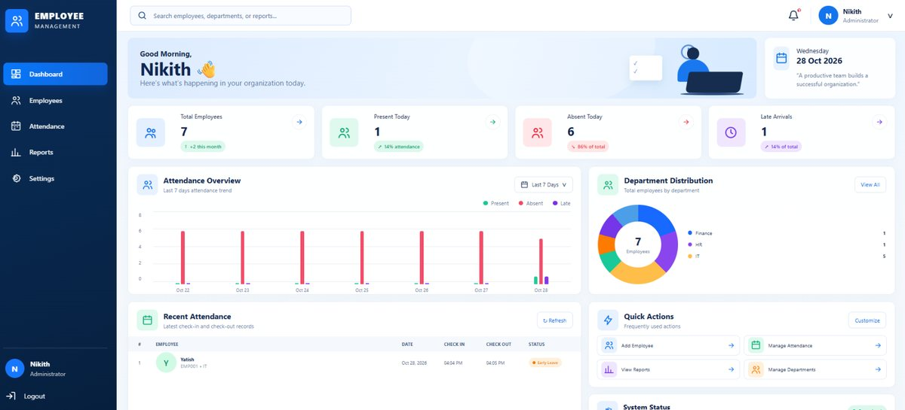
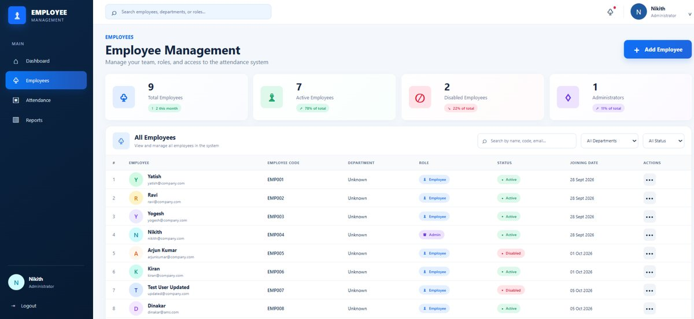
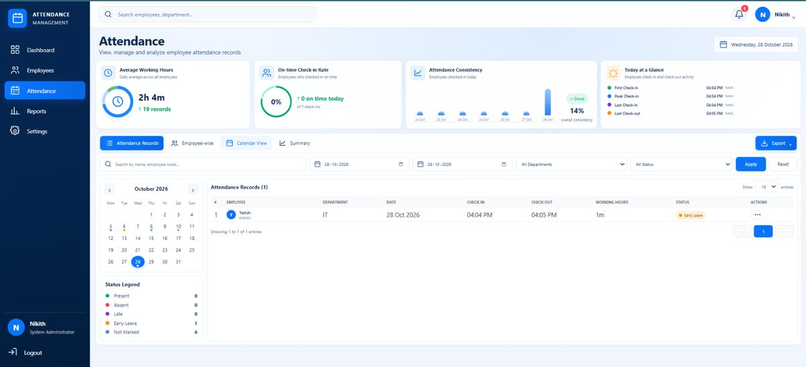
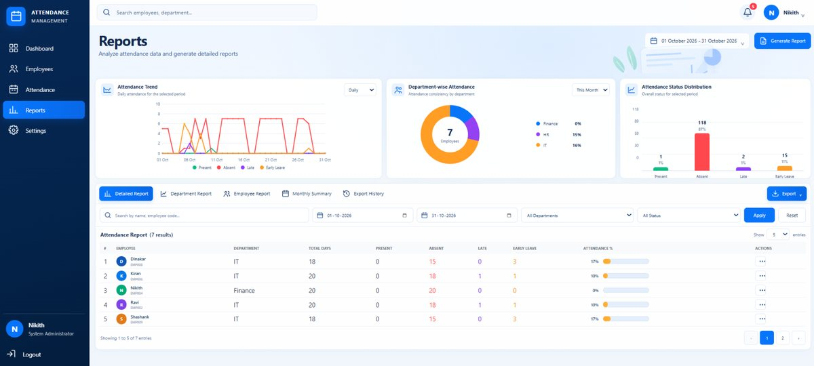
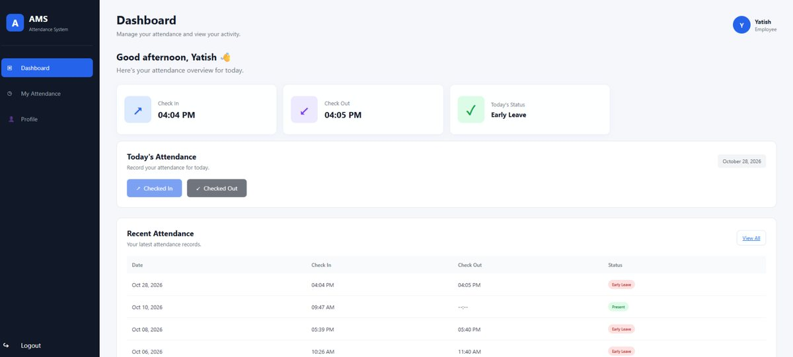
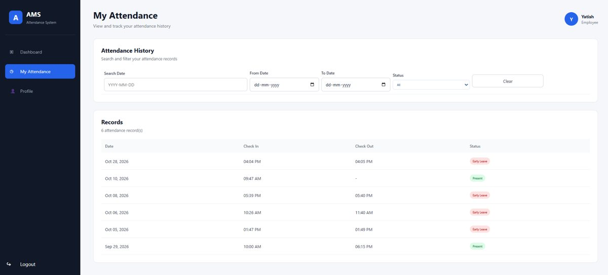
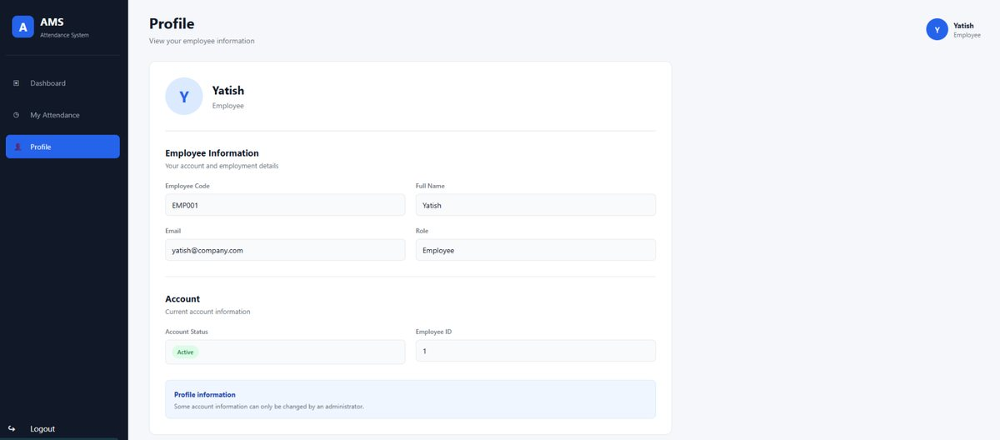

# Attendance Management System

A web-based attendance workspace with separate administrator and employee
portals. Administrators can review attendance, manage employees, and view
attendance reports. Employees can view their attendance and record check-in
and check-out times.

## Features

- Employee-code and password sign-in with role-based pages.
- Administrator dashboard with attendance summaries and recent activity.
- Employee management, including activation and department assignment.
- Attendance search and views for absent, late, and early-leaving employees.
- Attendance reports with filters and CSV export.
- Employee dashboard, personal attendance history, and profile pages.

## Screenshots

### Administrator

**Dashboard**

<p></p>

**Employee management**

<p></p>

**Attendance management**

<p></p>

**Reports**

<p></p>

### Employee

**Dashboard**

<p></p>

**My attendance**

<p></p>

**Profile**

<p></p>

## Requirements

- Node.js 22 or later and npm.
- Microsoft SQL Server with a database named `AttendanceDB`.
- The Microsoft ODBC Driver 18 for SQL Server.
- Windows Integrated Authentication for the configured local SQL Server.

## Configure the backend

From `backend`, copy `.env.example` to `.env` and set a unique JWT signing
secret. Keep `.env` local; it is ignored by Git.

Create the database tables using
[`database/01_create_tables.sql`](database/01_create_tables.sql). Add a
department before assigning it to an employee, then create the initial
administrator and employee records through your organization's approved
database setup process. Store only bcrypt password hashes in
`Employees.Password_hash`; never add real account passwords to the project.

For an existing set of employee records, the optional password-hash utility
reads `SEED_EMPLOYEE_IDS` and each matching `SEED_PASSWORD_EMPLOYEE_<id>` from
the local `backend/.env`. Passwords must be at least 12 characters. It does
not include default employee IDs or passwords.

Install dependencies and start the API:

```powershell
Set-Location backend
npm ci
npm run dev
```

The API listens on `http://localhost:5000`. Check
`http://localhost:5000/api/health` to verify it is responding. The API also
requires the SQL Server database to be available.

## Run the frontend

In another terminal:

```powershell
Set-Location frontend
npm ci
npm run dev -- --host 127.0.0.1
```

Open the Vite URL printed in the terminal (normally
`http://127.0.0.1:5173`). The frontend sends API requests to
`http://localhost:5000/api`.

Create a production frontend build with:

```powershell
Set-Location frontend
npm run build
```

## Demo accounts

This repository does not include demo usernames or passwords. Use employee
accounts created in your own `AttendanceDB` and follow your organization's
credential-handling policy. Passwords must not be added to README files, SQL
scripts, source code, screenshots, or commits.

## Project layout

```text
backend/
  scripts/       Local password-hash utility
  src/
    config/      SQL Server connection
    controllers/ API request handlers
    middleware/  Authentication and role checks
    routes/      API endpoints
database/        SQL Server schema setup
frontend/
  public/        Public icons and static assets
  src/
    components/  Shared route components
    pages/       Administrator and employee screens
    services/    API client
```
